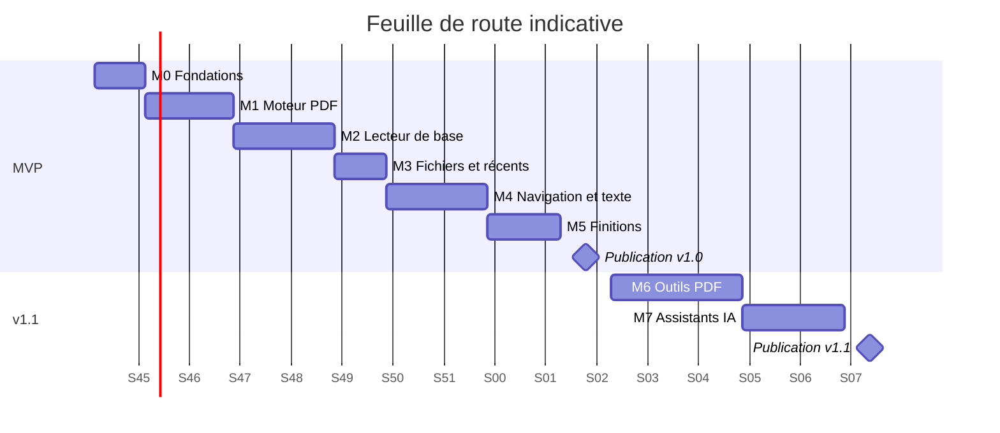

# Plan de réalisation et jalons

> À lire avec `SPEC.md` (le quoi) et `AGENTS.md` (le comment).
> Chaque jalon doit respecter la définition de « terminé » d'`AGENTS.md` avant de passer au suivant.

---

## 1. Inventaire des vues

### 1.1 Écrans complets (destinations de navigation)

| # | Écran | Version | Contenu principal |
|---|-------|---------|-------------------|
| E1 | Bibliothèque (accueil) | MVP | Récents en liste / grille, bouton « Ouvrir », état vide, accès aux outils et paramètres |
| E2 | Lecteur | MVP | Rendu du document, barres masquables, curseur de pages |
| E3 | Paramètres | MVP | Thème, mode nuit, défilement, orientation, écran allumé, récents |
| E4 | À propos et licences | MVP | Version, licence, lien source, licences tierces |
| E5 | Outils (accueil) | v1.1 | Accès à Fusion, Extraction, Conversion |
| E6 | Fusion | v1.1 | Ajout de fichiers, réordonnancement, plages de pages |
| E7 | Extraction de pages | v1.1 | Grille de miniatures, sélection de pages |
| E8 | Conversion en PDF | v1.1 | Sélection des fichiers, options de page, aperçu |
| E9 | Progression / résultat | v1.1 | Avancement, annulation, ouvrir / partager le résultat (partagé par E6–E8) |
| E10 | Paramètres « Assistants IA » | v1.1 | Interrupteurs d'autorisation, dossier de sortie, historique des actions |

### 1.2 Vues secondaires (panneaux, feuilles, dialogues)

| # | Vue | Version | Attachée à |
|---|-----|---------|-----------|
| V1 | Barre de recherche + résultats | MVP | Lecteur |
| V2 | Table des matières (panneau latéral / feuille) | MVP | Lecteur |
| V3 | Aller à la page (dialogue) | MVP | Lecteur |
| V4 | Mot de passe (dialogue) | MVP | Lecteur |
| V5 | Propriétés du document (feuille) | MVP | Lecteur |
| V6 | Menu d'options d'affichage (feuille) | MVP | Lecteur |
| V7 | Confirmation lien externe (dialogue) | MVP | Lecteur |
| V8 | Écrans d'erreur / d'état vide | MVP | Tous |
| V9 | Signets (panneau) | v1.x | Lecteur |
| V10 | Grille des miniatures | v1.x | Lecteur (réutilisée par E7) |

**Total : 4 écrans + 8 vues secondaires pour le MVP ; 10 écrans + 10 vues secondaires en v1.1.**
Les composants réutilisables (miniature de page, carte de document, sélecteur de fichiers, barre de progression) vont dans `core:ui`.

---

## 2. Jalons

Les durées sont **indicatives**, pour une personne seule assistée d'un agent de codage, et dépendent fortement du temps disponible.

### M0 — Fondations (≈ 1 semaine)
**Objectif :** un projet vide mais propre, où toute la qualité est automatisée.
- Structure des modules (`SPEC.md` §4.3), catalogue de versions, Hilt, Compose, thème Material 3.
- ktlint, detekt, Lint, Kover, Dokka configurés ; `allWarningsAsErrors`.
- CI : build, tests, couverture, **vérification de l'absence de permission réseau**, licences des dépendances.
- Fichiers `README`, `LICENSE`, `CONTRIBUTING`, `CHANGELOG`, `PRIVACY`, `docs/architecture.md`.
- Jeu de PDF de test dans `core:testing`.

**Sortie :** la CI est verte sur une application « Hello world », un test de chaque type tourne.

### M1 — Moteur PDF (≈ 1 à 2 semaines)
**Objectif :** pouvoir ouvrir et rendre n'importe quel PDF du jeu de test, sans interface.
- ~~ADR 0001 (MuPDF) relu et accepté~~ (fait le 2026-11-03) ; licence GPL-3.0-or-later + distribution AGPL v3 en place.
- Compilation de MuPDF depuis les sources (sous-module Git, NDK, version épinglée), intégrée à la CI.
- Interface `PdfEngine` + implémentation MuPDF : ouverture, mot de passe, rendu de région, métadonnées, table des matières, liens, texte, recherche.
- Vérification précoce des capacités d'écriture (fusion de 2 PDF, image vers PDF) pour valider la v1.1.
- Gestion des erreurs et libération des ressources natives.

**Sortie :** tests d'intégration verts sur tout le jeu de PDF, y compris corrompus.

### M2 — Lecteur de base (≈ 2 semaines) — vues E2, V8
**Objectif :** lire confortablement un document.
- Rendu en tuiles, cache LRU, défilement continu et page par page, zoom (pincer, double tap).
- Plein écran, curseur de pages, indicateur de page.
- Premiers benchmarks de défilement et d'ouverture.

**Sortie :** 60 fps sur un document de 500 pages, aucun crash mémoire sur le gros PDF de test.

### M3 — Ouverture de fichiers et bibliothèque (≈ 1 semaine) — vues E1, V4
**Objectif :** parcours complet « ouvrir un fichier → lire → revenir ».
- SAF, « Ouvrir avec », partage entrant ; permissions persistées.
- Récents avec vignettes, reprise de la dernière page, dialogue de mot de passe.

**Sortie :** test de bout en bout du parcours principal vert.

### M4 — Navigation et texte (≈ 2 semaines) — vues V1, V2, V3, V7
**Objectif :** trouver l'information dans un document.
- Table des matières, aller à la page, liens internes et externes.
- Recherche avec surlignage et navigation ; sélection et copie de texte.

**Sortie :** F05 à F09 validés sur le jeu de test (dont textes non latins).

### M5 — Finitions MVP (≈ 1 à 2 semaines) — vues E3, E4, V5, V6
**Objectif :** une application publiable.
- Thèmes, mode nuit du document, sépia, orientation, paramètres.
- Propriétés, partage, impression, À propos et licences.
- Accessibilité (TalkBack, contrastes, grandes polices), traductions FR/EN.
- Baseline Profile, tests de captures d'écran de tous les écrans.

**Sortie :** tous les critères d'acceptation MVP (`SPEC.md` §8) cochés.

### 🚀 Jalon de publication v1.0 (≈ 1 semaine)
- Build release signé et reproductible, métadonnées Fastlane FR/EN, captures d'écran.
- Soumission à **F-Droid** et **Google Play** (test interne puis production).
- Tag `v1.0.0`, CHANGELOG, annonce.

### M6 — Outils PDF (≈ 2 à 3 semaines) — vues E5 à E9
**Objectif :** fusionner, extraire et convertir sans quitter l'application.
- Interface `PdfWriter`, implémentée avec MuPDF.
- Fusion et extraction (T01, T02), puis conversion images, texte, HTML local (T03 à T05).
- WorkManager, progression, annulation, dossier de sortie, aucun écrasement.

**Sortie :** tests spécifiques aux outils (`AGENTS.md` §10) verts.

### M7 — Assistants IA (≈ 2 semaines) — vue E10
**Objectif :** piloter l'application depuis Gemini.
- ADR : AppFunctions (statut, dépendances, compatibilité F-Droid).
- Repli d'abord : intents documentés et raccourcis d'application.
- Puis AppFunctions : les 10 fonctions de `SPEC.md` §2.4, erreurs structurées.
- Paramètres « Assistants IA », lecture du contenu désactivée par défaut, historique.

**Sortie :** critères d'acceptation v1.1 cochés ; tests instrumentés sur Android 16+.

### 🚀 Jalon de publication v1.1 (≈ 1 semaine)
- Mise à jour des fiches F-Droid / Play (mention des outils et de l'intégration assistants, déclaration de confidentialité).
- Tag `v1.1.0`.

### M8 — Évolutions v1.x (au fil de l'eau)
Signets, annotations, formulaires, grille des miniatures, lecture à voix haute avancée, mode tablette (F20 à F26), selon les retours des utilisateurs.

---

## 3. Vue d'ensemble

Total indicatif : **≈ 11 à 13 semaines pour la v1.0**, **≈ 6 semaines de plus pour la v1.1**.

---

## 4. Risques principaux

| Risque | Impact | Parade |
|--------|--------|--------|
| Compilation native de MuPDF (NDK, temps de build, reproductibilité F-Droid) | Élevé | La mettre en place dès M1, version épinglée, cache de build en CI |
| Objets MuPDF non thread-safe (crashs natifs) | Moyen | Un dispatcher mono-thread par document, tests de concurrence |
| Performances de rendu sur appareils modestes | Moyen | Benchmarks dès M2, rendu en tuiles, cache borné |
| AppFunctions encore expérimental (API changeante) | Moyen | Faire le repli par intents d'abord ; module isolé et désactivable |
| Acceptation F-Droid (build reproductible, dépendances) | Moyen | Vérifications en CI dès M0 |
| Évolution de l'API ou de la licence de MuPDF | Faible | Version épinglée ; MuPDF isolé derrière `PdfEngine` / `PdfWriter`, PDFium comme plan B |

---

## 5. Comment utiliser ce plan avec l'agent

Donne-lui un jalon à la fois, par exemple :

> « Lis `SPEC.md`, `AGENTS.md` et `ROADMAP.md`. Réalise le jalon M0. Propose d'abord ton plan de tâches, puis implémente-le en respectant la définition de terminé. »

À la fin de chaque jalon, relis le résumé de l'agent, teste l'application toi-même, puis passe au suivant.
