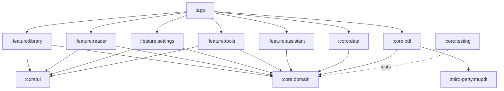
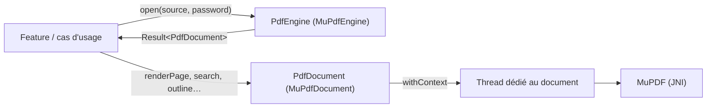
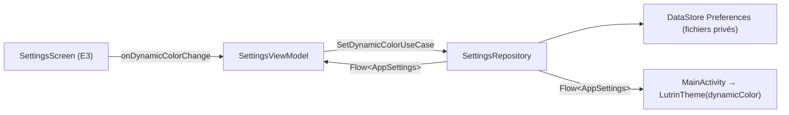
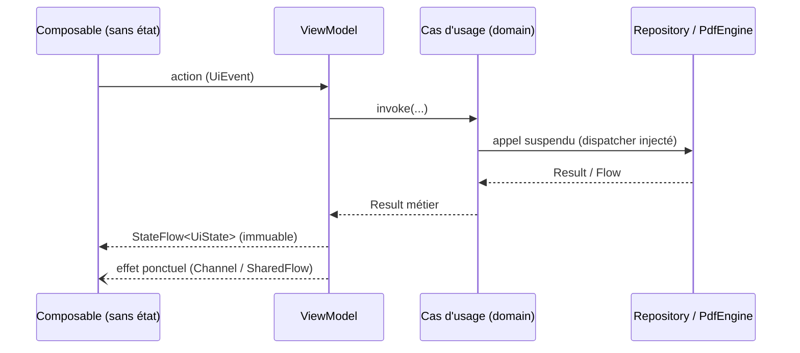

# Architecture

> Architecture décrite par `SPEC.md` §4. Les 11 modules existent depuis le jalon M0 et se
> remplissent au fil des jalons (`ROADMAP.md` §0). État au 2026-11-04 : `feature:tools` et
> `feature:assistant` sont encore vides.

## Principes

- **Clean Architecture + MVVM**, flux de données unidirectionnel (UDF).
- `core:domain` est en Kotlin pur (aucune dépendance Android).
- Un module `feature:*` ne dépend jamais d'un autre module `feature:*`.
- MuPDF n'est visible que dans `core:pdf`, derrière `PdfEngine` et `PdfWriter`.
- Les dispatchers sont injectés ; aucun travail lourd sur le thread principal.

## Modules

| Module | Rôle |
|--------|------|
| `:app` | Point d'entrée, navigation, assemblage de l'injection de dépendances |
| `:core:domain` | Modèles, interfaces de repository, cas d'usage (`operator fun invoke`) |
| `:core:data` | Repositories, Room (récents, positions, signets), DataStore (préférences) |
| `:core:pdf` | `PdfEngine` / `PdfWriter` et leur implémentation MuPDF |
| `:third-party:mupdf` | MuPDF compilé depuis son sous-module (Java + JNI, NDK) ; seul `core:pdf` en dépend (ADR 0007) |
| `:core:ui` | Thème Material 3 (jetons de `docs/design/design-tokens.json`), composants partagés |
| `:core:testing` | Fakes, utilitaires de test, jeu de PDF de test (`SPEC.md` §9) |
| `:feature:library` | Bibliothèque / récents (E1) |
| `:feature:reader` | Lecteur, recherche, table des matières, dialogues (E2, V1–V8) |
| `:feature:settings` | Paramètres, À propos, licences (E3, E4, E10) |
| `:feature:tools` | Fusion, extraction, conversion, progression (E5–E9) |
| `:feature:assistant` | AppFunctions, intents et raccourcis pour assistants IA |

## Dépendances entre modules

`core:pdf` et `core:data` implémentent les interfaces déclarées dans `core:domain` ;
`:app` les relie par injection de dépendances. Les features ne connaissent que le domaine.

## Moteur PDF (`core:pdf`)

- Un thread par document : tous les objets MuPDF y vivent et y sont détruits (`close()`).
- Les erreurs natives deviennent des `PdfError` (`core:domain`) ; aucune n'atteint l'UI en crash.
- Tests : sur la JVM avec la bibliothèque MuPDF compilée pour la machine de build, et
  instrumentés sur émulateur pour la bibliothèque Android.

## Lecteur (`feature:reader`)

- `ReaderViewModel` ouvre le document (URI reçue par la navigation) via `PdfEngine` et le ferme
  avec lui ; il expose `ReaderUiState` : `Loading`, `Error` (V8) ou `Ready`.
- `PageRenderer` produit les bitmaps : rendu de base de chaque page (cache LRU `BitmapCache`) et
  rendu net de la partie visible au-delà de « ajuster à la largeur » (ADR 0008).
- `ReaderScreen` / `PdfPagesView` (Compose) : `LazyColumn` des pages, gestes de zoom, barres,
  plein écran. Les calculs (zoom, partie visible, page courante) sont des fonctions pures de
  `ReaderGeometry.kt`, testées sur la JVM.
- Zoom au pincement : pendant le geste, la liste n'est que transformée visuellement
  (`PinchTransform` dans un `graphicsLayer`, sans nouvelle mise en page ni rendu) ; au lâcher,
  le zoom est appliqué une fois et `listPositionAfterGesture` calcule la page et le décalage qui
  gardent le contenu à l'endroit où le geste l'a laissé (`requestScrollToItem`, même image).
  Le double tap passe par le même chemin. Un geste à deux doigts est consommé jusqu'au bout :
  le doigt restant ne fait pas défiler la page.

## Paramètres (`feature:settings`, `core:data`)

- `AppSettings`, `SettingsRepository` et les cas d'usage sont dans `core:domain` ;
  `DataStoreSettingsRepository` dans `core:data` (une seule instance de DataStore par fichier,
  sur le dispatcher d'I/O injecté).
- `MainActivity` observe les paramètres : le thème change dès que l'interrupteur bouge, sans
  redémarrer (ADR 0010).

## Flux de données d'un écran

## Build

- `build-logic/` (build inclus) contient les plugins de convention appliqués par chaque module :

  | Plugin | Appliqué à | Ajoute |
  |--------|-----------|--------|
  | `lutrin.android.application` | `:app` | AGP application, Licensee, `verifyReleasePermissions`, émulateurs gérés |
  | `lutrin.android.library` | modules Android `core:*` | AGP bibliothèque |
  | `lutrin.android.compose` | `app`, `core:ui`, `feature:*` | Compose (BOM, compilateur) |
  | `lutrin.android.feature` | `feature:*` | bibliothèque + Compose + Hilt + `core:ui` / `core:domain` |
  | `lutrin.jvm.library` | `core:domain` | Kotlin/JVM pur |
  | `lutrin.hilt` | `app`, `feature:*` | Hilt + KSP |
  | `lutrin.android.robolectric` | `app`, `core:ui` | Robolectric hors ligne (jars Android résolus par Gradle) |

  Tous appliquent ktlint, detekt, Kover et Dokka, `allWarningsAsErrors` et Java 17.
- Versions : uniquement dans `gradle/libs.versions.toml`. Dépôts : uniquement dans
  `settings.gradle.kts` (`FAIL_ON_PROJECT_REPOS`).
- Identifiant d'application : `io.github.myxomatom.lutrin` (`.debug` en debug, ADR 0006).

