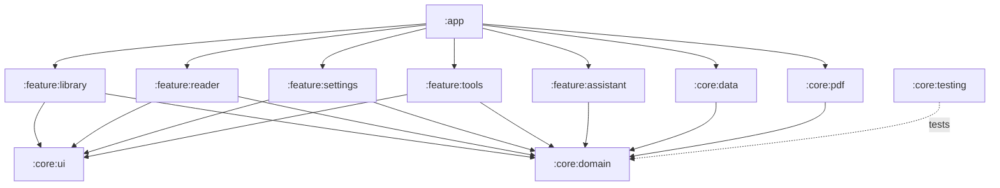
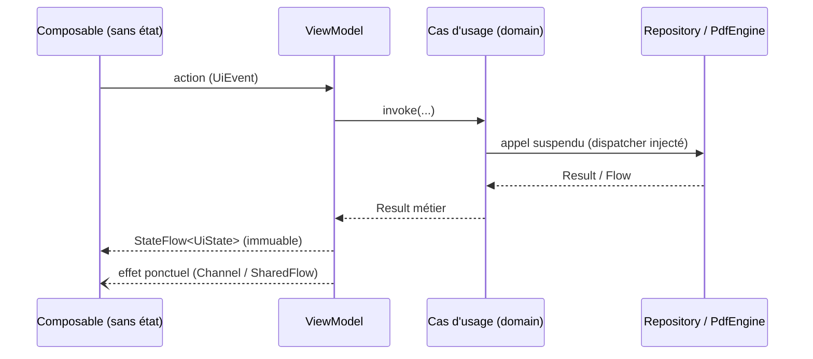

# Architecture

> Architecture décrite par `SPEC.md` §4. Les 11 modules existent depuis le jalon M0 ;
> la plupart sont encore vides et se remplissent au fil des jalons (`ROADMAP.md`).

## Principes

- **Clean Architecture + MVVM**, flux de données unidirectionnel (UDF).
- `core:domain` est en Kotlin pur (aucune dépendance Android).
- Un module `feature:*` ne dépend jamais d'un autre module `feature:*`.
- MuPDF n'est visible que dans `core:pdf`, derrière `PdfEngine` et `PdfWriter`.
- Les dispatchers sont injectés ; aucun travail lourd sur le thread principal.

## Modules

| Module | Rôle |
|--------|------|
| `:app` | Point d'entrée, navigation, assemblage de l'injection de dépendances |
| `:core:domain` | Modèles, interfaces de repository, cas d'usage (`operator fun invoke`) |
| `:core:data` | Repositories, Room (récents, positions, signets), DataStore (préférences) |
| `:core:pdf` | `PdfEngine` / `PdfWriter` et leur implémentation MuPDF (code natif) |
| `:core:ui` | Thème Material 3 (jetons de `docs/design/design-tokens.json`), composants partagés |
| `:core:testing` | Fakes, utilitaires de test, jeu de PDF de test (`SPEC.md` §9) |
| `:feature:library` | Bibliothèque / récents (E1) |
| `:feature:reader` | Lecteur, recherche, table des matières, dialogues (E2, V1–V8) |
| `:feature:settings` | Paramètres, À propos, licences (E3, E4, E10) |
| `:feature:tools` | Fusion, extraction, conversion, progression (E5–E9) |
| `:feature:assistant` | AppFunctions, intents et raccourcis pour assistants IA |

## Dépendances entre modules

`core:pdf` et `core:data` implémentent les interfaces déclarées dans `core:domain` ;
`:app` les relie par injection de dépendances. Les features ne connaissent que le domaine.

## Flux de données d'un écran

## Build

- `build-logic/` (build inclus) contient les plugins de convention appliqués par chaque module :

  | Plugin | Appliqué à | Ajoute |
  |--------|-----------|--------|
  | `lutrin.android.application` | `:app` | AGP application, Licensee, `verifyReleasePermissions`, émulateurs gérés |
  | `lutrin.android.library` | modules Android `core:*` | AGP bibliothèque |
  | `lutrin.android.compose` | `app`, `core:ui`, `feature:*` | Compose (BOM, compilateur) |
  | `lutrin.android.feature` | `feature:*` | bibliothèque + Compose + Hilt + `core:ui` / `core:domain` |
  | `lutrin.jvm.library` | `core:domain` | Kotlin/JVM pur |
  | `lutrin.hilt` | `app`, `feature:*` | Hilt + KSP |

  Tous appliquent ktlint, detekt, Kover et Dokka, `allWarningsAsErrors` et Java 17.
- Versions : uniquement dans `gradle/libs.versions.toml`. Dépôts : uniquement dans
  `settings.gradle.kts` (`FAIL_ON_PROJECT_REPOS`).
- Identifiant d'application : `io.github.myxomatom.lutrin` (`.debug` en debug, ADR 0006).

