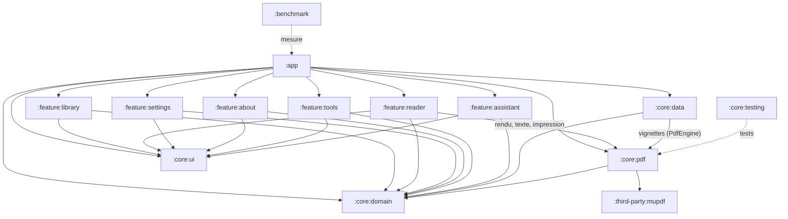
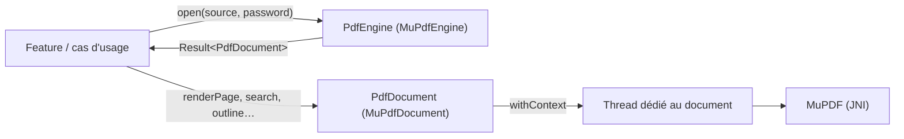
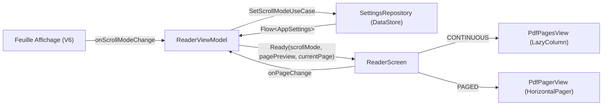
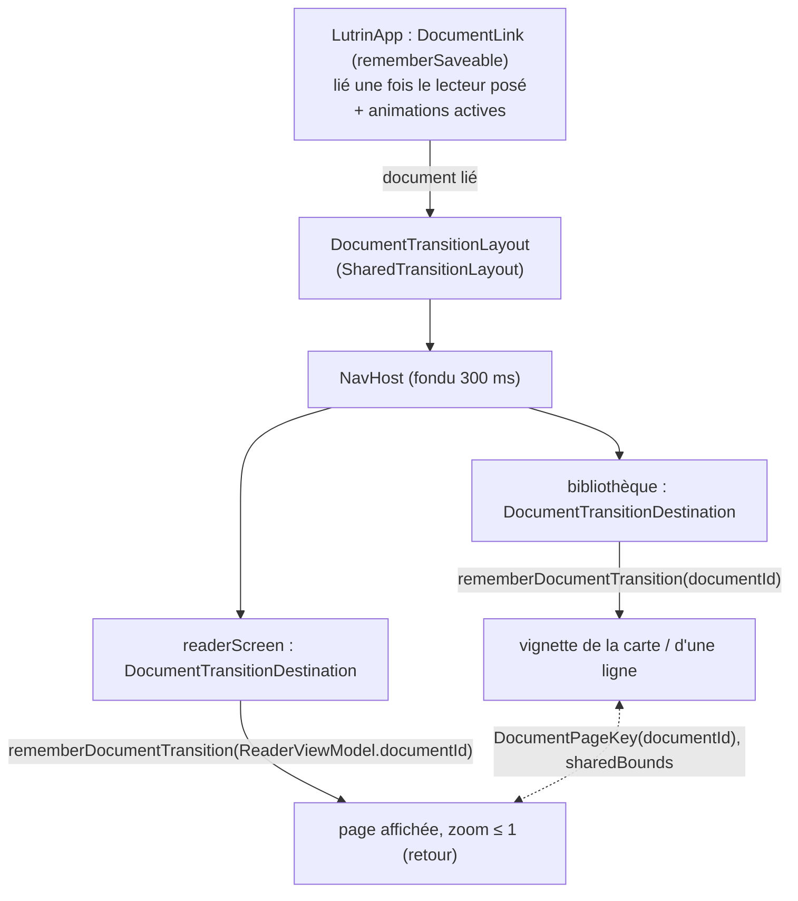
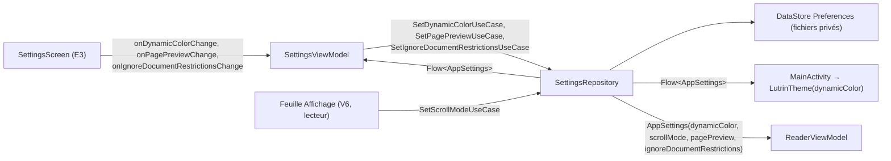
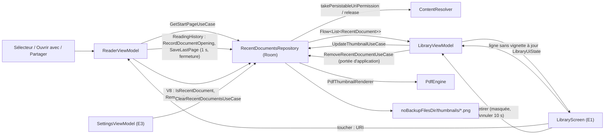
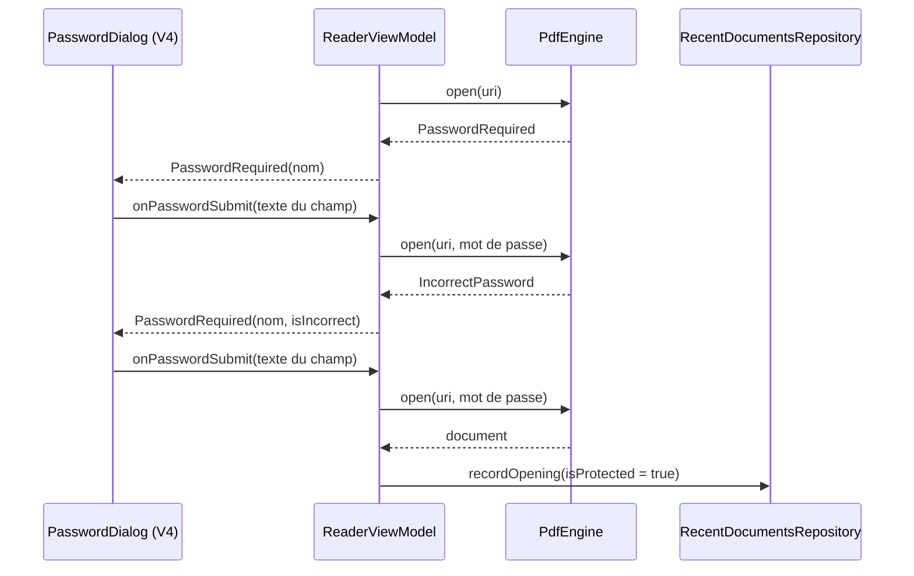
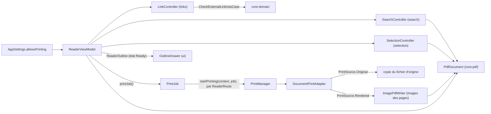
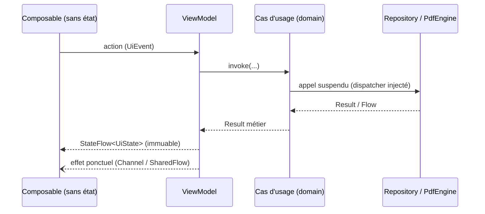

# Architecture

> Architecture décrite par `SPEC.md` §4. Les 11 modules existent depuis le jalon M0 et se
> remplissent au fil des jalons (`ROADMAP.md` §0). État au 2026-11-26 (M4 terminé, M5 en cours) : `feature:tools` et
> `feature:assistant` sont encore vides ; le module de test `:benchmark` s'y ajoute en M2
> (ADR 0012).

## Principes

- **Clean Architecture + MVVM**, flux de données unidirectionnel (UDF).
- `core:domain` est en Kotlin pur (aucune dépendance Android).
- Un module `feature:*` ne dépend jamais d'un autre module `feature:*`.
- MuPDF n'est visible que dans `core:pdf`, derrière `PdfEngine` et, à partir de M6, `PdfWriter` (aujourd'hui seul `ImagePdfWriter`,
  écart provisoire, voir « Impression »).
- Les dispatchers sont injectés ; aucun travail lourd sur le thread principal.

## Modules

| Module | Rôle |
|--------|------|
| `:app` | Point d'entrée, navigation, assemblage de l'injection de dépendances |
| `:core:domain` | Modèles, interfaces de repository, cas d'usage (`operator fun invoke`) |
| `:core:data` | Repositories, Room (récents, positions, signets), DataStore (préférences) |
| `:core:pdf` | `PdfEngine` et son implémentation MuPDF ; `PdfWriter` est prévu en M6 |
| `:third-party:mupdf` | MuPDF compilé depuis son sous-module (Java + JNI, NDK) ; seul `core:pdf` en dépend (ADR 0007) |
| `:core:ui` | Thème Material 3 (jetons de `docs/design/design-tokens.json`), composants partagés, portées de la transition vignette → lecteur (ADR 0019) |
| `:core:testing` | Fakes, utilitaires de test, jeu de PDF de test (`SPEC.md` §9) ; expose `core:pdf` (`api`) |
| `:feature:library` | Bibliothèque / récents (E1) |
| `:feature:reader` | Lecteur, recherche, table des matières, liens, sélection, impression, dialogues (E2, V1–V8) |
| `:feature:settings` | Paramètres (E3, E10) ; la ligne « À propos et licences » ouvre E4 par un rappel que `:app` branche |
| `:feature:about` | À propos et licences tierces (E4, ADR 0030) |
| `:feature:tools` | Fusion, extraction, conversion, progression (E5–E9) |
| `:feature:assistant` | AppFunctions, intents et raccourcis pour assistants IA |
| `:benchmark` | Module de test (`com.android.test`) : Macrobenchmark et générateur du Baseline Profile, lancés sur appareil contre les builds `benchmarkRelease` / `nonMinifiedRelease` de `:app` (ADR 0012) |

## Dépendances entre modules

`core:pdf` et `core:data` implémentent les interfaces déclarées dans `core:domain` ;
`:app` les relie par injection de dépendances. Les features ne connaissent que `core:ui` et le domaine
(plus `core:pdf` pour le lecteur ; `feature:assistant` et `feature:tools` les reçoivent du plugin
`lutrin.android.feature`, même vides). `core:testing` expose `core:pdf` en `api`, donc le domaine
par transitivité ; les modules `feature:*` l'ajoutent à leurs tests (plugin `lutrin.android.feature`). `core:data` utilise `PdfEngine` pour dessiner les vignettes
des récents, sans voir aucun type MuPDF (ADR 0015).

## Moteur PDF (`core:pdf`)

- Un thread par document : tous les objets MuPDF y vivent et y sont détruits (`close()`).
- Les erreurs natives deviennent des `PdfError` (`core:domain`) ; aucune n'atteint l'UI en crash.
- Tests : sur la JVM avec la bibliothèque MuPDF compilée pour la machine de build, et
  instrumentés sur émulateur pour la bibliothèque Android.

## Lecteur (`feature:reader`)

- `ReaderViewModel` ouvre le document (URI reçue par la navigation) via `PdfEngine` et le ferme
  avec lui ; il expose `ReaderUiState` : `Loading`, `Error` (V8) ou `Ready`.
- `PageRenderer` produit les bitmaps : rendu de base de chaque page (cache LRU `BitmapCache`) et
  rendu net de la partie visible au-delà de « ajuster à la largeur » (ADR 0008).
- `ReaderScreen` / `PdfPagesView` (Compose) : `LazyColumn` des pages, gestes de zoom, barres,
  plein écran. Les calculs (zoom, partie visible, page courante) sont des fonctions pures de
  `ReaderGeometry.kt`, testées sur la JVM.
- Zoom au pincement : pendant le geste, la liste n'est que transformée visuellement
  (`PinchTransform` dans un `graphicsLayer`, sans nouvelle mise en page ni rendu) ; au lâcher,
  le zoom est appliqué une fois et `listPositionAfterGesture` calcule la page et le décalage qui
  gardent le contenu à l'endroit où le geste l'a laissé (`requestScrollToItem`, même image).
  Le double tap passe par le même chemin. Un geste à deux doigts est consommé jusqu'au bout :
  le doigt restant ne fait pas défiler la page.
- Mode page par page (ADR 0011) : `PdfPagerView`, un `HorizontalPager` dont chaque page est
  une surface zoomable (l'écran multiplié par le zoom, défilable dans les deux sens), avec les
  mêmes gestes (`ReaderGestures.kt`) et le même `PdfPage` que le mode continu. Le zoom 1 y
  vaut « page entière » (`PagedGeometry.kt`).
- `PageNavigator` donne la page courante et le saut de page au curseur, à l'indicateur et au
  ViewModel, quel que soit le mode. Le mode vient des paramètres.
- Barre flottante (ADR 0018) : `ReaderDocumentArea` pose `FloatingPageBar` au-dessus des pages,
  qui défilent dessous jusqu'en bas de l'écran ; `floatingPageBarClearance()` donne aux deux vues
  l'espace de fin (marges système du bas, barre, marges). `PageScrubber` décide de ce que fait le
  curseur : avec l'aperçu (`AppSettings.pagePreview`, activé par défaut), le glissement ne fait
  que viser une page, montrée par `PagePreviewCard` (rendue par `PageRenderer.renderPreview`, dans
  un cache à part de 8 Mo) et le document y va au relâchement ; sans l'aperçu, le document suit
  le curseur.

## Transition vignette → lecteur (`core:ui`, `app`, ADR 0019)

- `app` choisit le seul document lié : celui que l'utilisateur a touché dans la bibliothèque,
  **une fois son lecteur posé** (entrée de navigation `RESUMED`, `DocumentLink`), tant que les
  animations du système sont actives. L'aller est donc un simple fondu ; seul le retour replie
  la page vers la vignette. Le sélecteur de fichier et les demandes des autres applications ne
  lient rien.
- Les deux features ne se connaissent pas : elles lisent les portées par
  `rememberDocumentTransition`, qui rend `null` hors de l'application (aperçus, tests,
  `BenchmarkReaderActivity`) ; les écrans fonctionnent alors sans transition.
- Dans le lecteur, c'est la page affichée qui porte l'élément partagé, pour le retour (geste
  prédictif compris).

## Paramètres (`feature:settings`, `core:data`)

- `AppSettings`, `SettingsRepository` et les cas d'usage sont dans `core:domain` ;
  `DataStoreSettingsRepository` dans `core:data` (une seule instance de DataStore par fichier,
  sur le dispatcher d'I/O injecté).
- `MainActivity` observe les paramètres : le thème change dès que l'interrupteur bouge, sans
  redémarrer (ADR 0010).
- Le mode de défilement du lecteur (`AppSettings.scrollMode`, ADR 0011) et l'aperçu du curseur
  (`AppSettings.pagePreview`, ADR 0018) sont stockés de la même façon. Le lecteur lit les deux
  et écrit le mode (feuille « Affichage ») par ses propres cas d'usage, sans dépendre de
  `feature:settings` ; l'aperçu se règle dans les Paramètres (section « Lecture »), et un
  lecteur ouvert suit le changement.
- `AppSettings.ignoreDocumentRestrictions` (ADR 0024, amendé par l'ADR 0026), désactivé par défaut,
  se règle aussi dans « Lecture ». `allowsTextCopy(documentAllowsCopy)` et
  `allowsPrinting(documentAllowsPrinting)` combinent la permission du document et ce réglage. La clé
  DataStore reste `ignore_copy_restriction` (pas de migration).

## Récents et reprise de lecture (`feature:library`, `feature:reader`, `core:data`)

- Table `recent_documents` (schéma exporté dans `core/data/schemas/`), au plus 50 entrées ;
  une entrée qui sort (éviction au-delà de 50, retrait, vidage : un seul chemin dans le dépôt)
  rend sa permission persistante, supprime sa vignette et perd sa page (ADR 0016).
- Retrait depuis la bibliothèque : la ligne est masquée aussitôt, le retrait effectif attend la
  fin du message « Annuler » et s'exécute dans la portée d'application ; il est ignoré si le
  document a été rouvert entre-temps. Depuis V8 et les paramètres, le retrait est immédiat
  (après confirmation pour le vidage). Aucun module `feature:*` ne dépend d'un autre : tous
  passent par les cas d'usage de `core:domain`.
- Le lecteur part de la page demandée (extra `page`), sinon de la page enregistrée, ramenée
  au document ; il enregistre la page une seconde après le dernier changement et à sa
  fermeture (portée `@ApplicationScope`).
- Les vignettes sont dessinées quand la bibliothèque montre une ligne dont la vignette manque
  ou date d'avant la dernière ouverture (ou d'un ancien format), jamais pendant l'ouverture du
  lecteur. Un seul fichier de 416 × 552 px au plus sert la carte « Reprendre la lecture » et
  les lignes, qui le décodent sous-échantillonné (`ThumbnailLoader`, ADR 0018).
- La bibliothèque montre le document le plus récent dans la carte « Reprendre la lecture » et
  les autres dessous (`LibraryUiState.Content(resume, others)`) ; la barre de progression
  n'apparaît que pour une lecture en cours (`RecentDocument.isReadingInProgress`).

## Documents protégés (`feature:reader`, ADR 0017)

- Le mot de passe n'existe que dans le champ du dialogue (`TextFieldState` non sauvegardable,
  vidé à sa disparition) et, le temps de l'appel au moteur, dans la coroutine de l'essai : jamais
  dans l'état, le `SavedStateHandle`, les arguments de navigation, Room, DataStore ni les
  journaux.
- Chaque essai suit le chemin d'ouverture normal (page de départ, récents, suivi de la page).
- Une entrée protégée (`is_protected`, schéma Room 2) n'a jamais de vignette : le dépôt ne
  demande pas au moteur de l'ouvrir.
- `LibraryViewModel` est rattaché à `MainActivity` ; `LutrinApp` reçoit son état en
  `StateFlow` et reste testable sans Hilt.

## Navigation et texte (M4, `feature:reader`, `core:pdf`)

Le lecteur est découpé en contrôleurs détenus par `ReaderViewModel`, un par fonction : le
ViewModel leur fournit la page courante, le document et les dispatchers injectés, et l'écran
n'observe que leurs `StateFlow` et leurs effets. Aucun ne voit de `Context`.

**API texte et destinations (ADR 0020).** `PdfEngine` expose le sommaire, les liens avec leur
destination (page et position), la recherche page par page avec extraits, `textAt` et la
sélection (mots, caractères, lignes), `isOnText` avec tolérance, et les permissions du document
(`canCopyText`, `canPrint`) rapportées sans être appliquées par le moteur.

**Table des matières (V2, ADR 0021).** Le ViewModel lit le sommaire une fois le document affiché,
hors du fil principal, et le met à plat dans `ReaderUiState.Ready.outline` (`ReaderOutline` :
entrées `OutlineEntry`, ensemble déplié, section courante). `OutlineDrawer` (`ModalNavigationDrawer`,
`OutlineHost`) l'affiche, paresseux, ouvert sur la section courante ; les entrées externes passent
par `onExternalOutlineEntry`, donc par `LinkController`.

**Liens (V7, ADR 0022).** `CheckExternalLinkUseCase` (`core:domain`) n'accepte que `http`, `https`
et `mailto`, après nettoyage de l'URI. `LinkController` suit les liens internes (effet `GoTo`, avec
« Revenir ») et garde l'URI externe en attente (`externalLink`) pour la confirmation
`ExternalLinkDialog` ; l'ouverture (`ACTION_VIEW`) est faite par la route, sans permission
réseau.

**Recherche (V1, ADR 0023).** `SearchController` lance la recherche 400 ms après la frappe (ou aussitôt
à la validation), depuis la page courante, annule la précédente et publie `SearchState` et
`SearchEffect.Reveal` ; les surlignages sont dessinés par `SearchHighlightLayer` dans `PdfPage`.

**Sélection et copie (F08, ADR 0024).** `SelectionController` expose `StateFlow<TextSelection?>` (une
page à la fois) et les effets `Copy`, `CopyRefused`, `NothingToCopy` ; l'écran copie dans le
presse-papiers (`SelectionEffectsHandler`), le texte d'un document protégé étant marqué sensible.
La copie obéit à `AppSettings.allowsTextCopy`.

**Polices CJK (ADR 0025).** Aucune police CJK n'est embarquée (la limite de 15 Mo par ABI serait
dépassée) : MuPDF dessine le texte CJK non incorporé avec les polices du système. Le build de
MuPDF (`MUPDF_EMBEDDED_RESOURCES`, `build-logic`) n'embarque que les polices URW et les motifs de
césure.

## Impression (M5, `feature:reader`, ADR 0026)

- Le bouton « Imprimer » de la barre flottante appelle `ReaderViewModel.printJob()`, qui relit à
  chaque appui la permission (`allowsPrinting(document.canPrint)`) et rend un `PrintJob` (nom,
  `PrintSource`, dispatcher d'E/S injecté), ou `null` si l'impression est interdite. `ReaderRoute`
  le passe à `startPrinting(context, job)` (paquet `print`), qui appelle `PrintManager.print`.
- `DocumentPrintAdapter` répond au service d'impression : `onLayout` ne dépend jamais du papier ;
  `onWrite` copie le fichier d'origine par blocs de 64 Kio (`PrintSource.Original`), ou, pour un
  document ouvert avec un mot de passe (`PrintSource.Rendered`), dessine les seules pages
  demandées à 150 ppp (abaissés au-delà de 8 millions de pixels) dans un PDF d'images. Annulation
  vérifiée entre deux blocs ou pages ; le PDF déchiffré n'est jamais écrit.
- **Écart provisoire à `AGENTS.md` §10** (toute écriture passe par `PdfWriter`) : `ImagePdfWriter`
  écrit ce PDF d'images lui-même, page par page, dans `feature:reader`, car `PdfWriter` n'existe
  pas encore. Il sera migré dans `core:pdf`, derrière `PdfWriter`, en M6.

## Flux de données d'un écran

## Build

- `build-logic/` (build inclus) contient les plugins de convention appliqués par chaque module :

  | Plugin | Appliqué à | Ajoute |
  |--------|-----------|--------|
  | `lutrin.android.application` | `:app` | AGP application, Licensee, `verifyReleasePermissions`, émulateurs gérés |
  | `lutrin.android.library` | `core:ui`, `core:data`, `core:pdf`, `core:testing`, `feature:*` (par `lutrin.android.feature`) | AGP bibliothèque |
  | `lutrin.android.test` | `:benchmark` | AGP `com.android.test`, ktlint et detekt (ni Kover, ni Dokka) |
  | `lutrin.mupdf` | `:third-party:mupdf` | tâche `generateMupdfResources` (ADR 0013) ; le module applique `android.library` directement |
  | `lutrin.android.compose` | `app`, `core:ui`, `feature:*` | Compose (BOM, compilateur) |
  | `lutrin.android.feature` | `feature:*` | bibliothèque + Compose + Hilt + `core:ui` / `core:domain` (`implementation`), `core:testing` en test |
  | `lutrin.jvm.library` | `core:domain` | Kotlin/JVM pur |
  | `lutrin.hilt` | `app`, `core:data`, `core:pdf`, `feature:*` (ces derniers par `lutrin.android.feature`) | Hilt + KSP |
  | `lutrin.android.robolectric` | `app`, `core:ui`, `core:data`, `feature:library`, `feature:reader`, `feature:settings` | Robolectric hors ligne (jars Android résolus par Gradle) |

  Les plugins `android.application`, `android.library` et `jvm.library` appliquent ktlint, detekt, Kover et Dokka, `allWarningsAsErrors` et Java 17 ; `android.test` seulement ktlint et detekt.
- Versions : uniquement dans `gradle/libs.versions.toml`. Dépôts : uniquement dans
  `settings.gradle.kts` (`FAIL_ON_PROJECT_REPOS`).
- Identifiant d'application : `io.github.myxomatom.lutrin` (`.debug` en debug, ADR 0006).

