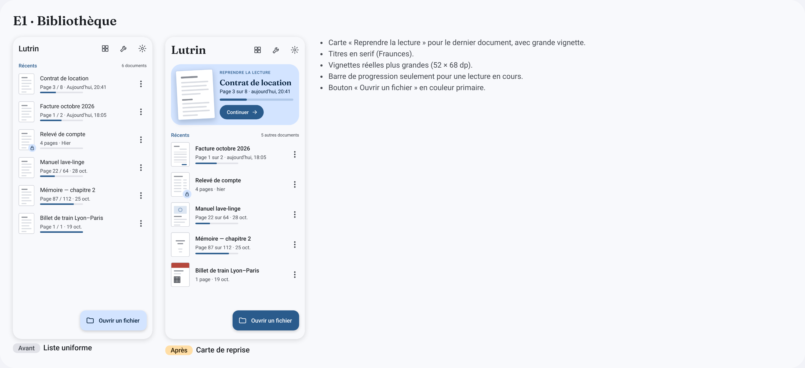
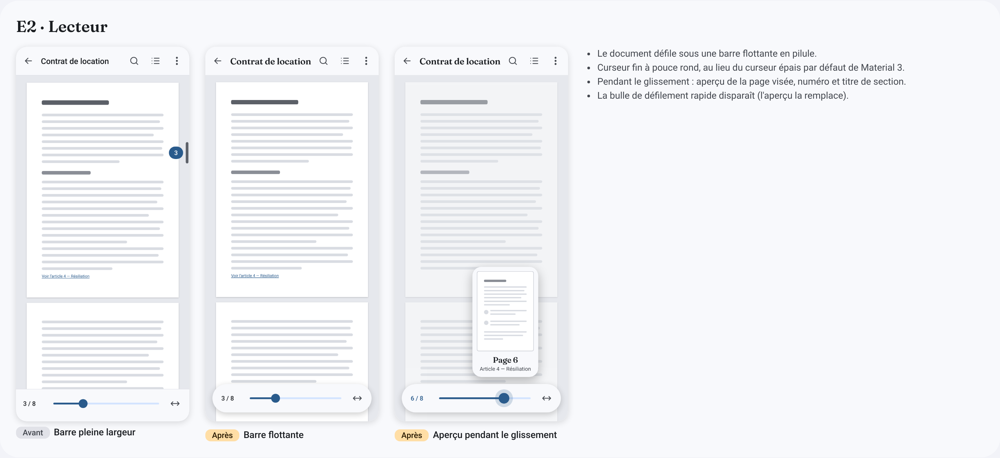
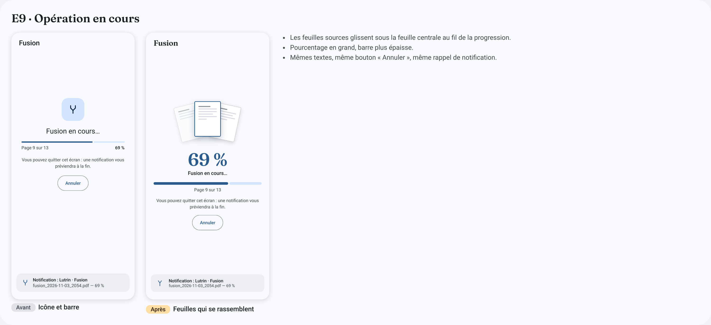
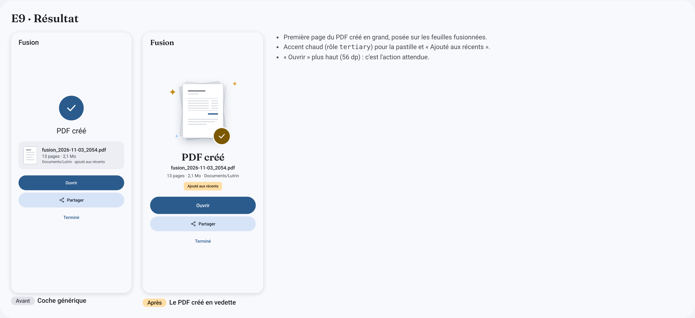
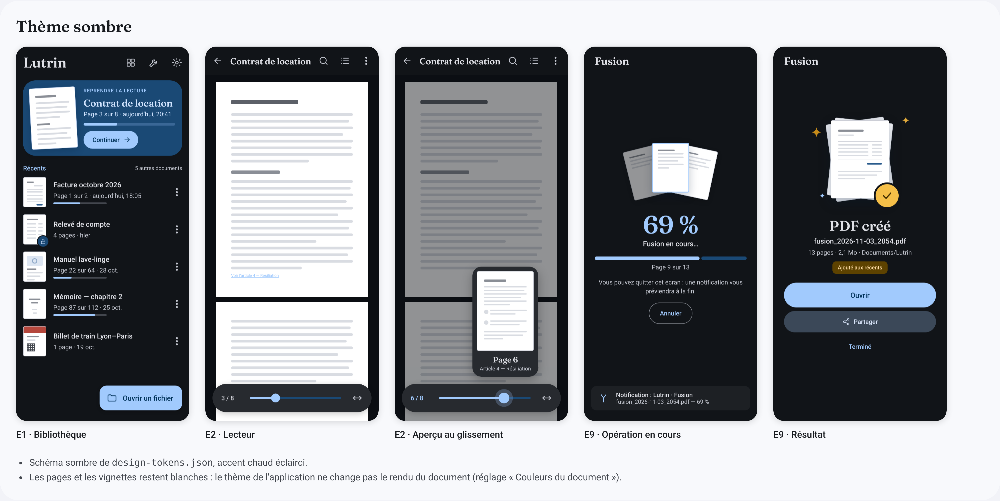

# Propositions de design — avant / après

> **Statut : propositions, non adoptées.** Les maquettes de référence restent celles de
> `docs/design/screens/` et `docs/design/png/` (`AGENTS.md` §11). Rien ici ne doit être
> implémenté tant qu'un ADR n'a pas acté l'écart avec les maquettes actuelles.
> Comme le reste de `docs/design/`, ces fichiers ne sont jamais embarqués dans l'APK.

Pistes pour donner plus de caractère à trois écrans : E1 (bibliothèque), E2 (lecteur) et
E9 (progression et résultat d'un outil). Ouvrir `index.html` dans un navigateur pour la
comparaison complète.

## Contenu

```
docs/design/proposals/
├── README.md        ← ce fichier
├── index.html       ← comparaison avant / après
├── proposal.css     ← styles communs aux écrans proposés
├── screens/*.html   ← un écran par page (hors ligne, sans script)
├── png/*.png        ← captures à 2× (780 × 1688 px) et planches avant-apres-*.png
└── fonts/           ← Fraunces 500 et 600 (OFL 1.1, @fontsource/fraunces 5.3.0)
```

## E1 · Bibliothèque



- Carte « Reprendre la lecture » pour le dernier document ouvert ; toute la carte est la
  cible tactile. Sa vignette est l'élément partagé d'une transition vers le lecteur
  (`SharedTransitionLayout` de Compose, aucune dépendance nouvelle).
- Vignettes de 52 × 68 dp au lieu de 44 × 58 dp.
- Barre de progression seulement pour une lecture en cours : plus de barre vide (document
  jamais ouvert) ni de barre pleine (document d'une page).
- Le nombre affiché compte les documents sous la carte (« 5 autres documents »).

## E2 · Lecteur



- Barre flottante en pilule : mêmes commandes que la barre actuelle (page, curseur,
  ajustement), le document défile dessous.
- Curseur fin (piste de 4 dp, pouce rond). L'application compilée affiche aujourd'hui le
  curseur par défaut de Material 3 (piste épaisse, poignée verticale, point d'arrêt), plus
  lourd que celui de la maquette de référence ; il se remplace par les paramètres `thumb`
  et `track` de `Slider` dans `PageBar` (`feature/reader/.../ReaderScreen.kt`).
- `E2-Lecteur-Curseur` : pendant le glissement, aperçu de la page visée avec son numéro, et
  le titre de section si le PDF a une table des matières. Le document ne change de page
  qu'au relâchement.
- **Décision du mainteneur (2026-11-10)** : l'aperçu est une option, activable ou non.
  Désactivée, le curseur garde le comportement actuel (le document suit le curseur en
  continu). Restent à fixer dans l'ADR : la valeur par défaut, le libellé, et la place du
  réglage (feuille « Affichage » V6 ou Paramètres E3).
- La bulle de défilement rapide à droite disparaît, l'aperçu la remplace.

## E9 · Progression et résultat




- Progression : les feuilles sources glissent sous la feuille centrale ; pourcentage en
  grand. Textes et actions inchangés.
- Résultat : première page du PDF créé (vignette réelle) à la place de la coche ; pastille
  et mention « Ajouté aux récents » dans l'accent chaud ; « Ouvrir » passe à 56 dp.

## Thème sombre



Chaque écran a sa variante `*-Sombre` (même page, classe `dark`), avec le schéma sombre de
`design-tokens.json`. Les pages et les vignettes restent blanches : le thème de
l'application ne change pas le rendu du document, qui dépend du réglage « Couleurs du
document » (F13). La barre flottante et l'aperçu utilisent `surfaceContainerHigh` pour se
détacher du fond du lecteur.

## Changements de jetons que l'adoption impliquerait

| Jeton | Actuel | Proposé |
|-------|--------|---------|
| Police des titres (`titleLarge`, `headlineSmall`, titre de la carte) | Roboto 400 | Fraunces 600, embarquée dans `core:ui` |
| `tertiary` / `tertiaryContainer` / `onTertiaryContainer` (clair) | `#6B5778` / `#F3DAFF` / `#523F5F` | `#7C5800` / `#FFDEA6` / `#271900` |
| Vignette de liste | 44 × 58 dp | 52 × 68 dp |

## Points à vérifier avant adoption

- **Couleurs dynamiques** : sur Android 12+, la palette vient du fond d'écran. L'accent
  chaud n'existe donc que dans le schéma de repli ; l'identité repose surtout sur la
  typographie et les transitions.
- **Schéma sombre** : voir ci-dessous ; l'accent chaud sombre (`tertiary` `#F5BF48`,
  `tertiaryContainer` `#5D4200`) est choisi à la main, à régénérer avec Material Color
  Utilities comme le reste du schéma.
- **Fraunces** : seul le sous-ensemble latin est copié ici ; vérifier la couverture
  nécessaire (`latin-ext`) et le poids ajouté à l'APK, puis l'inscrire dans
  `docs/dependencies.md`.
- **Animations** : prévoir l'état fixe quand les animations système sont réduites.
- **Contraste** : les couleurs de texte reprennent les rôles existants ; le blanc sur
  `#7C5800` et `#271900` sur `#FFDEA6` sont à mesurer avec l'outil du projet.

## Régénérer les captures

Chaque écran est capturé sur l'élément `.phone` (390 × 844) à l'échelle 2, fond
transparent ; les planches `avant-apres-*.png` et `theme-sombre.png` sont les sections de
`index.html`.
